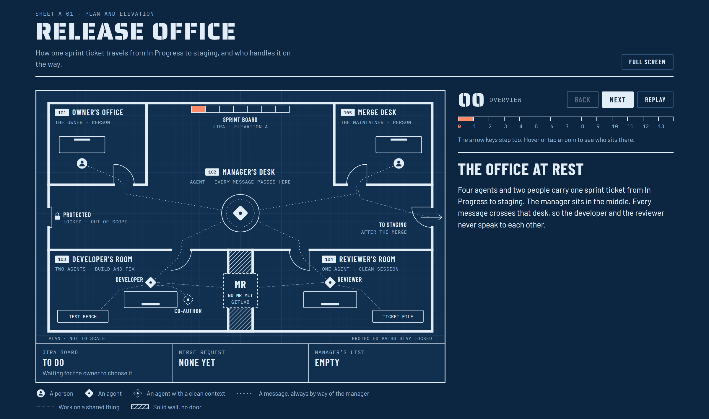

# Release Office

A small office of Claude Code agents that carries a Jira ticket from **In Progress** to
**deployed on staging**. You move a ticket to In Progress and press Start. The agents plan
nothing behind your back, ask you only what concerns you, and never approve or merge: the
merge stays with a person.



*The floor plan. Open `docs/release-office.html` in a browser to step through a ticket's
journey room by room.*

## How a ticket travels

1. **You** write the ticket with the planner skill, then move it to In Progress.
2. **The manager** checks the ticket is complete, makes a working copy on a branch named
   after the ticket, and hands it to the developer.
3. **The developer** builds and tests the change.
4. **The co-author** reads the local change with a clean context, before any merge request
   exists, and checks it against the ticket: every requirement met, every decision
   followed, nothing outside the scope.
5. **The developer** opens the merge request. The manager moves the ticket to Completed and
   writes the merge request link on it.
6. **The reviewer**, in its own clean session, maps the merge request to the ticket and posts
   a thread for every mismatch. The developer fixes, the reviewer re-checks.
7. When the review passes and the pipeline is green, **the manager** moves the ticket to
   Reviewed and assigns the merge request to **the maintainer**, a person, who merges it.
8. The manager moves the ticket to Deployed to Staging.

The manager sits in the middle: no agent talks to another, and every message crosses its
desk.

## What makes it work

- **The ticket is the contract.** The planner skill will not write a ticket until every fact
  in it was looked up and carries its source, every requirement says how to test it, and no
  question is left open. The manager turns away a ticket that is not in that shape.
- **The developer keeps one session for the whole ticket.** Each new message resumes it, so it
  remembers what it built, what the co-author found and what the reviewer said.
- **Clean eyes twice.** The co-author and the reviewer each start fresh, so they judge the
  change, not the developer's account of it.
- **Agents know when not to ask.** Small decisions (a name, a layout, one of two equal ways)
  the developer makes itself and lists under "Decisions I made" for review. Only questions
  that change the scope, the output or a decision reach you, on the control page.
- **A guard for unattended sessions.** Every tool call an agent makes is checked by a hook
  first: no protected paths, no credentials, no pushing by hand, no acting as another role.
  See [`docs/GUARDRAILS.md`](docs/GUARDRAILS.md).
- **Quiet on Jira.** The office writes two things on a ticket: the merge request link, and a
  design decision you choose to record. Everything else stays on the control page.

## Try it in two minutes

Nothing here touches Jira, GitLab or any repo.

```bash
python3 server.py --mode demo
```

Open http://127.0.0.1:8765, press **Start**, then **Move to In Progress** on a pretend
ticket. The page shows which agent is working and moves the ticket across the desks.

## Running it for real

You need Python 3.10 or newer, the Claude Code CLI, a Jira Cloud project and a GitLab
project.

**1. Settings and credentials.** Settings go in `office.config.json`, which is never
committed. Credentials go in one file outside the project, `~/.release-office/env`:

```bash
cp office.config.example.json office.config.json      # then fill it in
mkdir -p ~/.release-office
cat > ~/.release-office/env <<'ENV'
JIRA_EMAIL=you@example.com
JIRA_TOKEN=...
GITLAB_TOKEN=...
ENV
chmod 600 ~/.release-office/env
```

Anything else in that file (a database login, say) is handed to a command only when an
agent runs it through `officectl run --`. The Jira and GitLab tokens never leave `officectl`.

**2. Install the skills.** `./install-skills.sh` copies the five skills into
`~/.claude/skills`, with this folder's real path filled in.

**3. Start the backend** and open http://127.0.0.1:8765.

```bash
python3 server.py --mode auto      # the agents run by themselves once you press Start
python3 server.py --mode manual    # you start each role's skill, and step the manager by hand
```

In automatic mode the backend starts each role's session through the Claude CLI, one at a
time, behind the guard. It always comes up closed: nothing starts until you press Start.
**Close the office** stops new work from starting. Keep the terminal open.

**4. Plan a ticket and start it.** In a Claude Code session in your repo, talk the change
through, then run `/office-planner`. It writes the ticket into Jira when you say so. Move it
to In Progress and press Start.

When the developer needs you, the ticket appears under **Needs you**. Open it to read the
developer's question and everything it recorded, ask it for more through the manager, and
give your answer.

## Adapting it to your repo

- **`repo.path`, `gitlab.target_branch`** and the Jira and GitLab settings in
  `office.config.json`.
- **`repo.protected_paths`**: folders the agents must never read or change, such as
  regulated data or vendored code. The guard refuses them and the planner keeps them out of
  scope.
- **`guard.run_commands`**: the commands that run your code and tests (`uv run` and
  `uv sync` by default). Add `npm test`, `make test` or whatever your repo uses.
- **The skills** in `skills/office-*/SKILL.md` follow your repo's own rules file (a
  contributing guide, `AGENTS.md` or `CLAUDE.md`) and its CI. Add anything specific to your
  team there.

## Starting a ticket again

To throw a run away and start the same ticket from scratch: close the office, close its
merge request, then

```bash
python3 officectl.py forget <KEY>
git -C <repo> worktree remove ~/.release-office/worktrees/<KEY>
git -C <repo> branch -D <KEY>
```

Delete the remote branch if it was pushed, make sure the ticket is In Progress, and press
Start.

## What is in this folder

| Path | What it is |
|---|---|
| `skills/office-*/SKILL.md` | The five skills: planner, manager, developer, co-author, reviewer |
| `officectl.py` | The one tool every role uses: read the message, read the ticket, talk to GitLab, report |
| `server.py`, `ui/index.html` | The backend and the control page |
| `office/` | The manager's state machine, the Jira and GitLab clients, the plan check, the demo |
| `guards/` | The guard and the permission settings every unattended session runs behind |
| `office.config.example.json` | The settings to copy and fill in. No secrets |
| `docs/` | The architecture, the guardrails, and the floor plan |
| `tests/` | The whole flow, walked end to end against pretend systems |

The task list, the agents' notes, working copies and logs live in `~/.release-office`,
outside any repo.

## Tests

```bash
python3 -m unittest discover -s tests -t .
```

Standard library only.

## Limits

- Every role works on your own GitLab token, so each note an agent posts carries a label
  saying which role wrote it.
- The guard stops accidents and the direct routes. It is not a sandbox: an agent that may
  run your tests can run code.
- It speaks to Jira Cloud and GitLab only.
